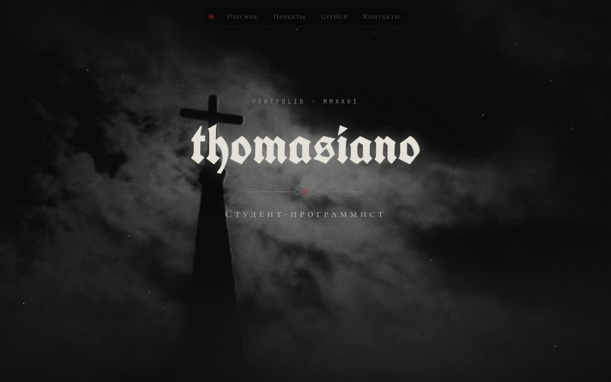

<div align="center">

# ✠ thomasiano · портфолио

**Личный сайт-портфолио в стиле dark gothic: обо мне, проекты и активность на GitHub.**

[**→ Открыть сайт**](https://thomasidze.github.io/)




</div>

---

## О сайте

Одностраничный сайт из четырёх разделов:

| | Раздел | Что внутри |
|---|---|---|
| I | **Обо мне** | учёба, что изучаю, навыки |
| II | **Проекты** | карточки со статусом (в разработке / обновляется / завершён) и ссылками |
| III | **Летопись** | сетка коммитов и статистика с GitHub, подгружаются вживую |
| IV | **Контакты** | GitHub, Telegram, почта с кнопкой «Копировать» |

На фоне идут зацикленные чёрно-белые видео: шпиль с крестом в облаках, а ближе к концу страницы — туманное кладбище. Поверх них ползёт туман, оседает пыль и мерцает плёнка.

## Анимации и эффекты

| Эффект | Как сделано | Файл |
|---|---|---|
| Буквы имени поднимаются из темноты | Anime.js `splitText` + `stagger` | `Hero.jsx` |
| Подзаголовки «расшифровываются» из рун | Anime.js `scrambleText` | `Hero.jsx` |
| Орнаменты-разделители прорисовываются линией | Anime.js `createDrawable` | `Ornament.jsx` |
| Смена фоновых сцен при прокрутке | Motion `useScroll` + `useTransform` | `Background.jsx` |
| Туман, пыль, зерно, мерцание плёнки | canvas + CSS-анимации | `Background.jsx`, `index.css` |
| Появление блоков из размытия | Motion `whileInView` | `Reveal.jsx` |
| Подсветка карточки под курсором и 3D-наклон | Motion springs | `Projects.jsx` |
| «Пилюля» в меню и полоска прогресса | Motion `layoutId`, `useScroll` | `Nav.jsx` |
| Искры по клику | canvas | `ClickSpark.jsx` |
| Счётчики статистики GitHub | Motion `animate` | `GithubActivity.jsx` |
| Заставка: разгорается крест, тьма расходится занавесом | Motion | `Intro.jsx` |
| Молнии в облаках раз в 20–40 секунд | Web Animations API | `Background.jsx` |
| Фон слегка следует за мышью (параллакс) | Motion springs | `Background.jsx` |
| Помехи на имени при наведении, как на VHS | CSS `clip-path` + `@keyframes` | `Hero.jsx`, `index.css` |
| Магнитные кнопки и ссылки | Motion springs | `Magnetic.jsx` |
| Тлеющий огонёк по краю карточки | CSS `@property` + `conic-gradient` | `Projects.jsx`, `index.css` |

Идеи эффектов взяты из [React Bits](https://reactbits.dev), [Animata](https://animata.design), [Kokonut UI](https://kokonutui.com) и примеров [Motion](https://motion.dev/examples) и [Anime.js](https://animejs.com). Сами компоненты написаны под этот сайт. Если в системе включено «уменьшение движения», анимации отключаются.

## Запуск

Нужен Node.js 20.19+ или 22.12+.

```bash
npm install
npm run dev      # http://localhost:5173
npm run build    # сборка в dist/
npm run preview  # посмотреть сборку локально
```

## Структура

```
src/
├── data/profile.js      ← весь контент сайта: тексты, навыки, контакты, проекты, фон
├── components/          ← разделы страницы и эффекты
├── assetUrl.js          ← пути к файлам, чтобы сайт работал и в подпапке
└── index.css            ← цвета, шрифты, туман, зерно
public/
├── bg/                  ← фоновые видео и их превью
└── projects/            ← обложки проектов
media/                   ← исходные гифки фона
.github/workflows/       ← автопубликация на GitHub Pages
```

## Как поменять контент

Всё лежит в [`src/data/profile.js`](src/data/profile.js), код трогать не нужно.

- **Проект:** добавь объект в `projects`. `status` бывает `'dev'` (в разработке), `'live'` (вышел и обновляется) или `'done'` (завершён). Обложку положи в `public/projects/`. `pinned: true` закрепляет проект на главной (до четырёх). Если проектов больше, чем закреплённых, под ними появляется кнопка «Показать все проекты» с фильтром по статусу.
- **Фото:** положи в `public/` и укажи путь в `avatar`.
- **Почта** хранится частями (`user` и `domain`). Сайт склеивает её в браузере, поэтому в коде нет готового адреса для спам-ботов.

### Свой фон из гифки

Видео весит в 5–20 раз меньше гифки. Перегнать гифку в mp4 и сделать превью-кадр:

```bash
ffmpeg -i media/my.gif -vf "scale=1280:-2:flags=lanczos,format=yuv420p" -c:v libx264 -crf 24 -movflags +faststart -an public/bg/my.mp4
```

```bash
ffmpeg -i public/bg/my.mp4 -frames:v 1 public/bg/my.jpg
```

Если в гифке мало кадров и она дёргается, добавь в начало `-vf` `setpts=2*PTS,minterpolate=fps=30,`: видео замедлится, а промежуточные кадры дорисуются. Потом добавь сцену в `background` в `profile.js`. Поле `from` задаёт, с какой доли прокрутки (от 0 до 1) она проявляется.

## Публикация

При каждом пуше в `main` сайт сам собирается и выкладывается на GitHub Pages ([`deploy.yml`](.github/workflows/deploy.yml)). В новом репозитории это нужно один раз включить: **Settings → Pages → Source: GitHub Actions**.

## Благодарности

- Шрифты: [UnifrakturCook](https://fonts.google.com/specimen/UnifrakturCook), [Ruslan Display](https://fonts.google.com/specimen/Ruslan+Display), [Cormorant](https://fonts.google.com/specimen/Cormorant+Garamond), [JetBrains Mono](https://fonts.google.com/specimen/JetBrains+Mono)
- Календарь коммитов: [react-github-calendar](https://github.com/grubersjoe/react-github-calendar)
- Фоновые гифки найдены на Pinterest, авторы неизвестны
